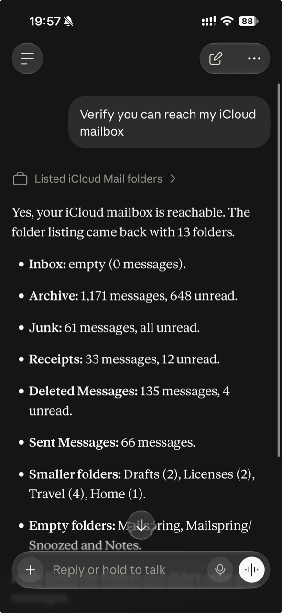

# icloud-mail-mcp

A small remote MCP server that lets Claude search, read and archive iCloud Mail.
It runs as one Cloudflare Worker, talks IMAP over implicit TLS to
`imap.mail.me.com:993`, and signs Claude in with OAuth gated by Cloudflare Access.

<p align="center"></p>

## What it can do

| Tool | Does | Changes mail? |
| --- | --- | --- |
| `list_folders` | Folder names with message and unread counts | No |
| `search_messages` | One folder, by date range, sender, subject, unread. Newest first, max 50 | No |
| `read_message` | Headers and plain-text body (512 KB raw, 20k chars text). Attachments listed, not returned | No (opens the folder read-only, so nothing is marked read) |
| `archive_messages` | Moves up to 50 messages to Archive | Yes, a move only |

There is no send, delete, flag or mark-read tool. Archive uses IMAP `MOVE`
when the server has it. Without `MOVE` it needs `UIDPLUS`: ImapFlow then
copies the messages, flags just those as `\Deleted` in the source folder and
runs `UID EXPUNGE` on exactly those UIDs, so it can never purge other messages
already marked deleted. With neither, it refuses. iCloud
currently takes the `UIDPLUS` path. If the server reports a failed move, the
tool returns an error rather than claiming success.
Archive is a separate OAuth scope (`mail:archive`) that you tick on the consent
page, so you can connect read-only first.

## How sign-in works

```
Claude ──OAuth (DCR/CIMD, PKCE)──▶ Worker /authorize ◀── Cloudflare Access (only your email)
   │                                   │  verifies the Access JWT again, then shows a consent page
   └──── bearer token ────▶ Worker /mcp ──IMAP over TLS──▶ imap.mail.me.com:993
```

- Cloudflare Access protects only `/authorize`. Claude's servers must reach
  `/token`, `/register` and `/mcp` directly, and those are protected by the
  OAuth tokens instead.
- The Worker checks the Access JWT itself too (issuer, audience, owner email),
  so a loosened Access policy still cannot let anyone else in.
- Authorization codes go only to `https://claude.ai` or `https://claude.com`
  redirect hosts (`ALLOWED_REDIRECT_HOSTS`).
- The app-specific password lives only as a Worker secret. Tokens and grants
  live hashed and encrypted in KV (by `@cloudflare/workers-oauth-provider`).

## Layout

- `src/store.ts`: the allowed operations, as an interface
- `src/imap-store.ts`: that interface over ImapFlow (search, read, archive)
- `src/tools.ts`: MCP tool definitions and input validation
- `src/mcp-http.ts`: stateless Streamable HTTP handler. Serves the 2026-07-28
  MCP protocol through the v2 TypeScript SDK and still answers 2025-era clients
- `src/access.ts`: Cloudflare Access JWT check and redirect allowlist
- `src/consent.ts`: the consent page
- `src/imap-client.ts`: per-call IMAP session over `cloudflare:sockets`
- `src/worker.ts`: wires OAuth, Access and MCP together
- `test/`: 68 tests against synthetic fixtures (no real mail)

## Develop

```sh
cp wrangler.example.jsonc wrangler.jsonc   # git-ignored; fill in your values
npm ci
npm test          # vitest, synthetic fixtures only
npm run typecheck
npx wrangler deploy --dry-run --outdir dist   # bundle without deploying
```

Setup and deploy steps are in [SETUP.md](SETUP.md).

## License

MIT. See [LICENSE](LICENSE).
